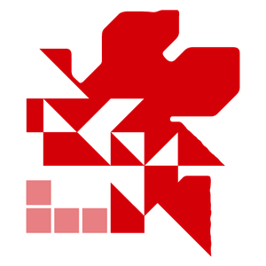

<p align="center">
  <a href="https://kodi.nerv.cx/"></a>
</p>

<p align="center">
  <a href="https://github.com/nightah/nerv.addons/actions/workflows/release.yml"><picture><source media="(prefers-color-scheme: dark)" srcset="https://shieldcn.dev/badge/dynamic/json.svg?url=https%3A%2F%2Fimg.shields.io%2Fgithub%2Factions%2Fworkflow%2Fstatus%2Fnightah%2Fnerv.addons%2Frelease.yml.json&query=%24.message&label=release&logo=githubactions&logoColor=%232088ff&mode=dark&size=sm&variant=outline"></picture></a>
  <a href="https://kodi.nerv.cx/"><picture><source media="(prefers-color-scheme: dark)" srcset="https://shieldcn.dev/badge/dynamic/json.svg?url=https%3A%2F%2Fimg.shields.io%2Fbadge%2Fdynamic%2Fxml.json%3Furl%3Dhttps%253A%252F%252Fkodi.nerv.cx%252Frepository.nerv%252Faddons.xml%26query%3D%252F%252Faddon%255B%2540id%253D%2527repository.nerv%2527%255D%252F%2540version%26label%3Dv&query=%24.message&label=repository&logo=kodi&logoColor=%2317b2e7&mode=dark&size=sm&variant=outline"></picture></a>
  <a href="https://kodi.tv/download/"><picture><source media="(prefers-color-scheme: dark)" srcset="https://shieldcn.dev/badge/dynamic/json.svg?url=https%3A%2F%2Fimg.shields.io%2Fbadge%2Fkodi-20%252B-blue.json&query=%24.message&label=kodi&logo=kodi&logoColor=%2317b2e7&mode=dark&size=sm&variant=outline"></picture></a>
  <a href="https://docs.astral.sh/ruff/"><picture><source media="(prefers-color-scheme: dark)" srcset="https://shieldcn.dev/badge/dynamic/json.svg?url=https%3A%2F%2Fimg.shields.io%2Fbadge%2Fcode%2520style-ruff-blue.json&query=%24.message&label=code%20style&logo=ruff&logoColor=%23d7ff64&mode=dark&size=sm&variant=outline"></picture></a>
  <a href="https://www.gnu.org/licenses/gpl-3.0"><picture><source media="(prefers-color-scheme: dark)" srcset="https://shieldcn.dev/badge/dynamic/json.svg?url=https%3A%2F%2Fimg.shields.io%2Fgithub%2Flicense%2Fnightah%2Fnerv.addons.json&query=%24.message&label=licence&logo=gnu&logoColor=%23a42e2b&mode=dark&size=sm&variant=outline"></picture></a>
  <a href="https://www.conventionalcommits.org/"><picture><source media="(prefers-color-scheme: dark)" srcset="https://shieldcn.dev/badge/dynamic/json.svg?url=https%3A%2F%2Fimg.shields.io%2Fbadge%2Fcommits-conventional-blue.json&query=%24.message&label=commits&logo=conventionalcommits&logoColor=%23fe5196&mode=dark&size=sm&variant=outline"></picture></a>
</p>

# nerv.addons

Kodi addons by nightah, published as the **NERV Repository** at <https://kodi.nerv.cx/>.

## Addons

| Addon | Description | Version |
| --- | --- | --- |
| [Kayo Sports](plugin.video.kayo/README.md) (`plugin.video.kayo`) | Live channels, live events, replays, and shows from your Kayo Sports subscription | <a href="https://github.com/nightah/nerv.addons/releases?q=plugin.video.kayo&expanded=true"><picture><source media="(prefers-color-scheme: dark)" srcset="https://shieldcn.dev/badge/dynamic/json.svg?url=https%3A%2F%2Fimg.shields.io%2Fbadge%2Fdynamic%2Fxml.json%3Furl%3Dhttps%253A%252F%252Fkodi.nerv.cx%252Frepository.nerv%252Faddons.xml%26query%3D%252F%252Faddon%255B%2540id%253D%2527plugin.video.kayo%2527%255D%252F%2540version%26label%3Dv&query=%24.message&label=kayo&logo=kodi&logoColor=%2317b2e7&mode=dark&size=sm&variant=outline"></picture></a> |
| NERV Repository (`repository.nerv`) | Keeps the addons above installed and up to date | <a href="https://kodi.nerv.cx/"><picture><source media="(prefers-color-scheme: dark)" srcset="https://shieldcn.dev/badge/dynamic/json.svg?url=https%3A%2F%2Fimg.shields.io%2Fbadge%2Fdynamic%2Fxml.json%3Furl%3Dhttps%253A%252F%252Fkodi.nerv.cx%252Frepository.nerv%252Faddons.xml%26query%3D%252F%252Faddon%255B%2540id%253D%2527repository.nerv%2527%255D%252F%2540version%26label%3Dv&query=%24.message&label=repository&logo=kodi&logoColor=%2317b2e7&mode=dark&size=sm&variant=outline"></picture></a> |

## Install

1. **Settings → File manager → Add source**, enter `https://kodi.nerv.cx/`, and name it `NERV`.
2. **Add-ons → Install from zip file → NERV**, then choose `repository.nerv-<version>.zip`.
3. **Add-ons → Install from repository → NERV Repository**, then pick an addon.

> [!NOTE]
> The NERV Repository also carries SlyGuy's feed, so dependencies such as `script.module.slyguy` install automatically.

## Development

Git hooks are managed with [Lefthook](https://lefthook.dev). Install the tools it checks for with your package manager of choice:

- [editorconfig-checker](https://github.com/editorconfig-checker/editorconfig-checker)
- [jq](https://jqlang.org)
- [kodi-addon-checker](https://github.com/xbmc/addon-check)
- [Lefthook](https://lefthook.dev)
- [Ruff](https://docs.astral.sh/ruff/)
- [ShellCheck](https://www.shellcheck.net)
- [typos](https://github.com/crate-ci/typos)
- [yamllint](https://github.com/adrienverge/yamllint)
- [zizmor](https://docs.zizmor.sh)

Then install the hooks:

```bash
lefthook install
```

| Hook | Checks |
| --- | --- |
| pre-commit | editorconfig-checker, jq, kodi-addon-checker, Ruff lint and format (`.ruff.toml`), ShellCheck, typos in en-AU (`.typos.toml`), yamllint, zizmor on GitHub workflows |
| commit-msg | Lowercase [Conventional Commits](https://www.conventionalcommits.org/) subject, at most 72 characters, with an optional scope of `deps`, `github`, `kayo`, `lefthook`, or `repository` |

## Build

```bash
./build.sh
```

This rebuilds `dist/` as the published site:

```text
dist/
├── index.html                  links the repository zip for Kodi's file browser
├── repository.nerv-<version>.zip
└── repository.nerv/            the Kodi repository feed
    ├── addons.xml
    ├── addons.xml.md5
    └── <addon id>/<addon id>-<version>.zip
```

## Releasing

Each addon is released on its own with a `<addon id>-v<version>` tag. Bump `version` in that addon's `addon.xml`, commit, then push the matching tag:

```bash
git tag plugin.video.kayo-v1.0.1 && git push origin plugin.video.kayo-v1.0.1
```

The [release workflow](.github/workflows/release.yml) then:

1. Builds `dist/` and checks the tag matches the addon's version.
2. Creates a GitHub release for that addon, with notes since its previous tag and its zip attached.
3. Deploys `dist/` to GitHub Pages at <https://kodi.nerv.cx/>.

## Acknowledgements

These addons are built on the work of [Matt Huisman (SlyGuy)](https://www.matthuisman.nz/).

* His common module, `script.module.slyguy`, does the heavy lifting: Widevine CDM installation, InputStream Adaptive setup, the local stream proxy, settings, and bookmarks.
* His [IPTV Merge](https://www.matthuisman.nz/2019/02/iptv-merge-kodi-add-on.html) puts the live channels into Kodi's TV section.

The NERV Repository pulls these straight from [his repository](https://www.matthuisman.nz/2020/02/slyguy-kodi-repository.html) and doesn't re-host them. If these addons are useful to you, consider [supporting his work](https://www.matthuisman.nz/support-me).

## Licence

The addons and this repository are licensed under the [GNU General Public License v3.0](LICENSE) or, at your option, any later version.
