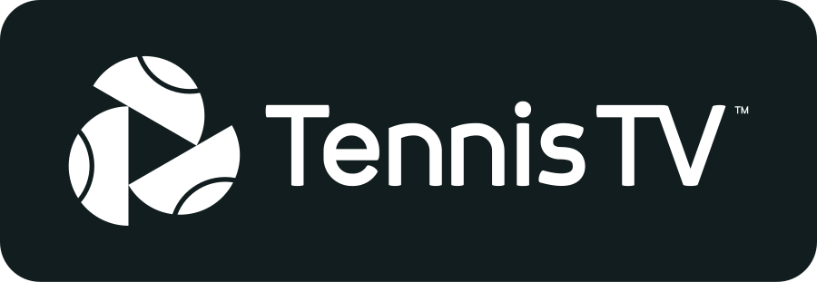

<p align="center">
  
</p>

<p align="center">
  <a href="https://github.com/nightah/nerv.addons/releases?q=plugin.video.tennistv&expanded=true"><picture><source media="(prefers-color-scheme: dark)" srcset="https://shieldcn.dev/badge/dynamic/json.svg?url=https%3A%2F%2Fimg.shields.io%2Fbadge%2Fdynamic%2Fxml.json%3Furl%3Dhttps%253A%252F%252Fkodi.nerv.cx%252Frepository.nerv%252Faddons.xml%26query%3D%252F%252Faddon%255B%2540id%253D%2527plugin.video.tennistv%2527%255D%252F%2540version%26label%3Dv%26cacheSeconds%3D300&query=%24.message&label=tennistv&logo=kodi&logoColor=%2317b2e7&mode=dark&size=sm&variant=outline"></picture></a>
  <a href="https://kodi.tv/download/"><picture><source media="(prefers-color-scheme: dark)" srcset="https://shieldcn.dev/badge/dynamic/json.svg?url=https%3A%2F%2Fimg.shields.io%2Fbadge%2Fkodi-20%252B-blue.json&query=%24.message&label=kodi&logo=kodi&logoColor=%2317b2e7&mode=dark&size=sm&variant=outline"></picture></a>
  <a href="https://www.python.org/"><picture><source media="(prefers-color-scheme: dark)" srcset="https://shieldcn.dev/badge/dynamic/json.svg?url=https%3A%2F%2Fimg.shields.io%2Fbadge%2Fpython-3.8%252B-blue.json&query=%24.message&label=python&logo=python&logoColor=%233776ab&mode=dark&size=sm&variant=outline"></picture></a>
  <a href="https://www.gnu.org/licenses/gpl-3.0"><picture><source media="(prefers-color-scheme: dark)" srcset="https://shieldcn.dev/github/nightah/nerv.addons/license.svg?label=licence&logo=gnu&logoColor=%23a42e2b&mode=dark&size=sm&variant=outline"></picture></a>
</p>

# Tennis TV for Kodi

`plugin.video.tennistv` plays your own Tennis TV subscription in Kodi.

- **Live:** match feeds, the alternate angles (HawkVision, HawkAR, MultiViewer), and the Tennis TV 24/7 channel
- **Replays, highlights, features and interviews** grouped by type
- **Browse by tournament, player, or year**
- **Search** across the Tennis TV catalogue
- **My Watchlist:** the videos saved to your account

Tennis TV runs on StreamAMG's Kaltura-based platform, so the addon talks to Tennis TV's APIs (`api.tennistv.com` and `*.streamamg.com`). Video on demand is unencrypted, so there is no DRM to deal with. It is built on SlyGuy's common module (`script.module.slyguy`), which handles InputStream Adaptive setup, settings, and bookmarks.

## Requirements

- Kodi 20 or newer
- An active Tennis TV subscription

## Install

Install the [NERV Repository](../README.md#install), then **Add-ons → Install from repository → NERV Repository → Video add-ons → Tennis TV**. Kodi then keeps the addon updated.

Open the addon, choose **Login**, then scan the QR code or go to the shown URL on any device and enter the code to pair. Sign in happens in your browser, so no password is ever entered in Kodi; only the session token is stored.

<details>
<summary>Installing from a zip instead</summary>

Download `plugin.video.tennistv-<version>.zip` from [GitHub releases](https://github.com/nightah/nerv.addons/releases?q=plugin.video.tennistv&expanded=true) and use **Add-ons → Install from zip file**. This gets no automatic updates, and Kodi still needs the NERV Repository (or the [SlyGuy repository](https://www.matthuisman.nz/2020/02/slyguy-kodi-repository.html)) installed to fetch the `script.module.slyguy` dependency.

</details>

## Testing outside Kodi

`tests/smoke.py` runs the addon's real `api.py` against the live services, with small shims standing in for the SlyGuy modules.

```bash
python3 -m pip install requests
python3 plugin.video.tennistv/tests/smoke.py --login
```

Without `--login` it only checks the public catalogue. With `--login` it runs the device-code sign in, then checks:

- token refresh
- the entitlement and StreamAMG entry chain for a video
- the manifest, and that it is clear (no DRM)

The token is cached in `plugin.video.tennistv/tests/.userdata.json` (git-ignored, mode 600).

## Licence

Licensed under the [GNU General Public License v3.0](LICENSE.txt) or, at your option, any later version.
